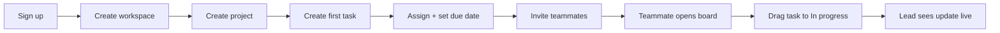

# TaskFlow — Product Requirements (v1)

Status: Draft · Owner: Ly · Last updated: 2026-10-14

## 1. Problem

Small teams (3–15 people) coordinate work across chat (Zalo, Slack), spreadsheets and free Trello boards.

- The team lead spends ~30 min/day asking "who is working on what?" because status lives in people's heads and chat threads.
- Late tasks are noticed only after the deadline has passed.
- Trello is easy but has no real permissions or change history; Jira has both but is too heavy and too expensive for a team this size.
- Clients and stakeholders get status by screenshot, because giving them access means giving them edit rights.

## 2. Users

| Persona | Role in TaskFlow | What they do every day |
| --- | --- | --- |
| Team lead | owner / admin | Creates projects, assigns tasks, checks what is late |
| Team member | member | Picks up tasks, moves them across the board, comments |
| Client / stakeholder | viewer | Checks progress, never edits |

## 3. Job to be done

> "When I start my day, I want to see who is doing what and what is about to slip, so that I can unblock people without a status meeting or a round of chat messages."

## 4. Goals (v1)

1. A new team gets from sign-up to its first assigned task in **under 3 minutes**, with no guide.
2. Everyone on a board sees the same state: a task moved in one tab appears in every other open tab in **under 1 second**.
3. A viewer can follow progress **without any ability to change data**.
4. A workspace's data is **never visible to another workspace**.

## 5. Non-goals (v1)

- Sprints, story points, burndown, Gantt / timeline views
- Time tracking, billing, invoicing
- Native mobile apps (the web app must work at 375px width instead)
- Third-party integrations (Slack, GitHub, calendar)
- Custom fields and workflow automation
- SSO / SAML

## 6. Scope (v1)

| Area | Included |
| --- | --- |
| Accounts | Register, log in, stay logged in (refresh token rotation), log out |
| Workspaces | Create a workspace, invite members by email, 4 roles: owner, admin, member, viewer |
| Projects & board | Projects inside a workspace; a board per project with status columns |
| Tasks | Title, description, status, assignee, priority, due date, labels; comments; file attachments |
| Board interaction | Drag and drop to reorder / change status; live updates for everyone on the board |
| History & search | Activity log per workspace; full-text search over tasks |
| AI assist | Paste a free-text description ("we need to launch the landing page next week…") → a draft list of structured tasks the user reviews before saving |

## 7. Key user flow

Secondary flows: accept an invite → land on the board; viewer opens a shared project read-only; AI draft → review → save tasks.

Every screen in these flows must define its **empty, loading, error and success** states.

## 8. Success metrics

| Metric | Target | How we measure |
| --- | --- | --- |
| Time to first task (new user) | < 3 min, no guide | Usability test with 3 people; product analytics event timestamps |
| Main-flow completion in usability test | 3 / 3 testers | Click-through test on mockup and on prototype |
| Realtime propagation | < 1 s p95 between tabs | E2E test with 2 API instances; client-side timing |
| Board load (`GET tasks`) | p95 < 200 ms at 100k tasks | k6 load test |
| Cross-tenant data leaks | 0 | E2E isolation tests in CI |

## 9. Risks and open questions

- **Concurrent edits:** two people edit the same task at once → decision: reject the later write with a conflict (409) instead of silently overwriting.
- **Ordering at scale:** reordering must not rewrite every task in a column → fractional indexing (see ADR).
- **AI output is untrusted:** drafts are validated against a schema and always reviewed by a human before saving.
- **Open:** do viewers need comments? (v1 answer: no — read-only.)
